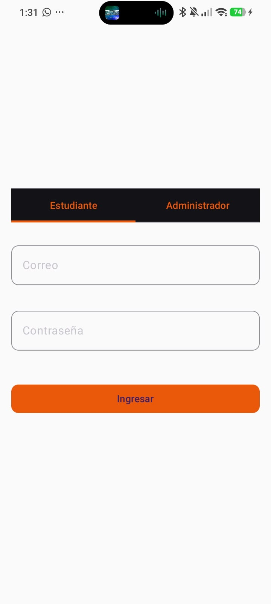
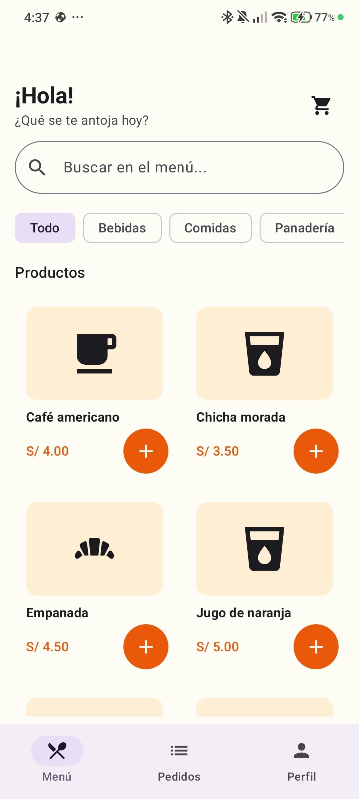
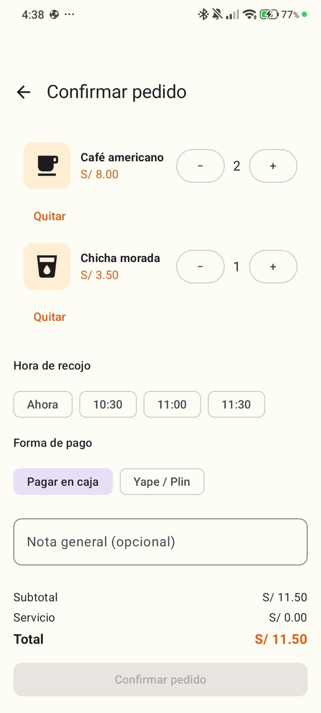
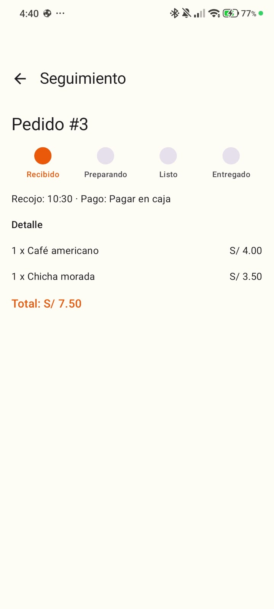
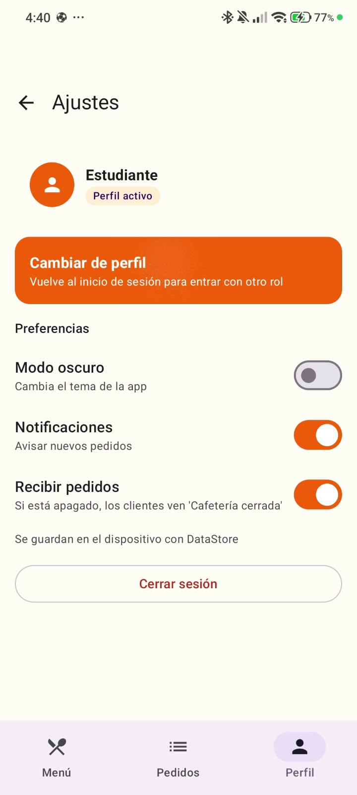
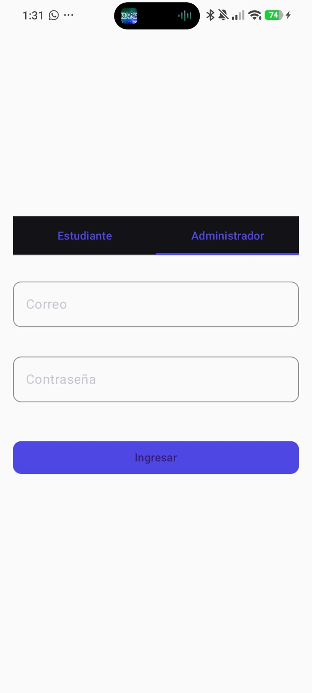
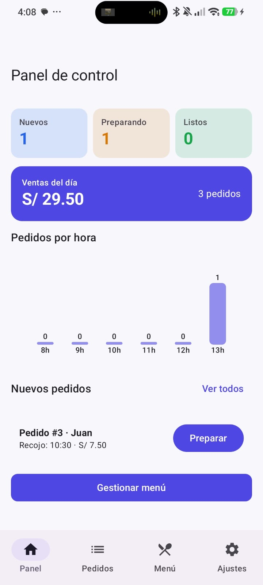
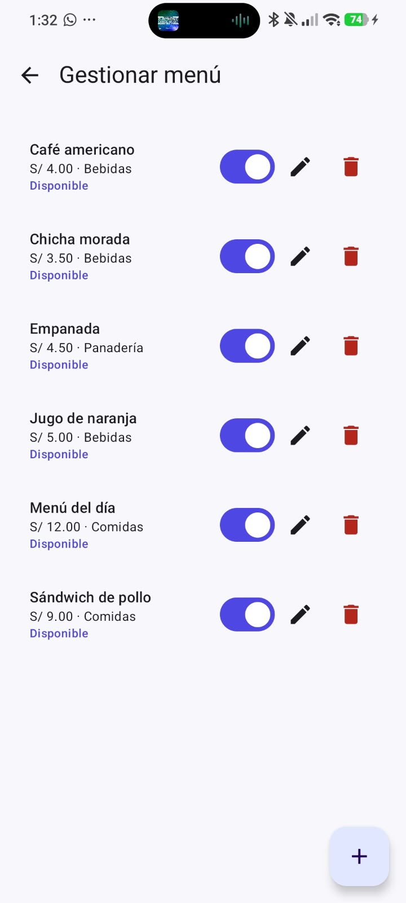
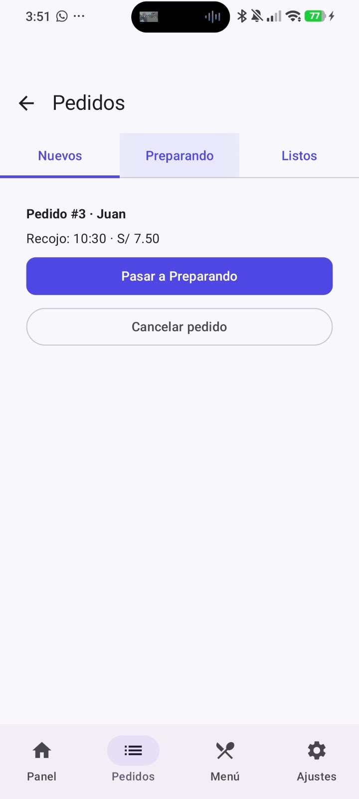
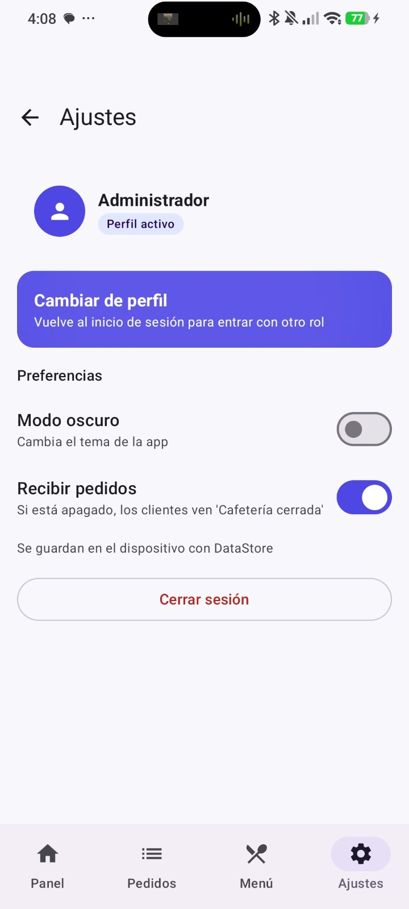

# CafeCampus

Es una app Android para pedir en la cafetería del campus sin hacer cola. El estudiante arma su pedido desde el celular, elige la hora de recojo y puede seguir su pedido hasta que esté listo. Del lado de la cafetería, el encargado ve los pedidos nuevos, los pasa a preparando y los marca como listos o entregados.

Lo hice para el laboratorio de Programación en Móviles (Semana 08), usando MVVM y Room.

## Qué usé

- Kotlin y Jetpack Compose con Material 3
- Room 2.7.2 con KSP para guardar productos, pedidos y usuarios
- DataStore para recordar la sesión, el modo oscuro y algunas opciones de la cafetería
- Navigation Compose para moverme entre pantallas
- Un tema distinto por rol: naranja para el estudiante y morado para el administrador

## Cómo está organizado

```
app/src/main/java/com/yaycate/cafecampus/
├── data/        base de datos Room, DataStore y el repositorio
├── model/       Rol, EstadoPedido e ItemCarrito
├── ui/          pantallas del cliente y del admin, componentes, navegación y tema
└── viewmodel/   los ViewModels y su factory
```

## Cuentas para probar

| Rol           | Correo           | Contraseña                         |
|---------------|------------------|------------------------------------|
| Estudiante    | juan@campus.test | la que está en `DatosIniciales.kt` |
| Administrador | admin@cafe.test  | la que está en `DatosIniciales.kt` |

## Cómo se usa

1. Entro como estudiante, reviso el menú y abro un producto para elegir cantidad y, si quiero, una nota para la cocina.
2. Confirmo el pedido con hora de recojo y forma de pago.
3. Sigo el pedido en Seguimiento o en Mis pedidos, donde separo los activos del historial.
4. Como administrador, el pedido aparece en Nuevos. Lo paso a Preparando, después a Listo y finalmente a Entregado. También puedo cancelarlo.
5. En el panel veo las ventas del día, cuántos pedidos hay en cada estado y los pedidos por hora.

## Cosas que cambié o no llegué a hacer

- Usé Room 2.7.2 porque con la 2.6.1 me salía un error de KSP en el proyecto.
- La sesión se queda guardada: si cierro la app, al abrirla de nuevo sigo con mi cuenta.
- En el celular del estudiante, la pestaña Perfil abre Ajustes.
- "Cambiar de perfil" cierra la sesión y me manda al login. No lo hice cambiar de rol directo porque cualquiera podría entrar como admin sin contraseña.
- El switch de Notificaciones guarda la preferencia, pero todavía no oculta el contador de la campana.
- El tiempo de preparación es fijo (10 – 15 min) para todos los productos, porque el modelo no tiene un tiempo por producto.
- La hora de recojo y el pago tienen opciones fijas.
- El saludo dice solo "¡Hola!", porque no guardo el nombre al iniciar sesión.
- El cargo por servicio sale en S/ 0.00. Lo puse en el resumen pero no lo cobro.

## Cómo correrlo

Abrir `Semana08/CafeCampus` en Android Studio, esperar a que sincronice Gradle y correr la app en un emulador o celular con Android 8.0 o superior.

## Capturas

Captura de Usuario







Captura de Admin






