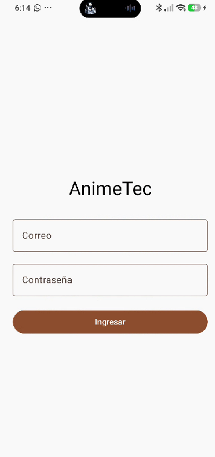
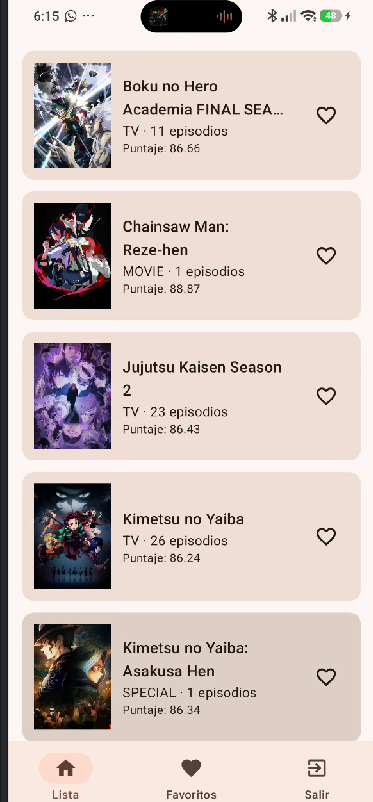
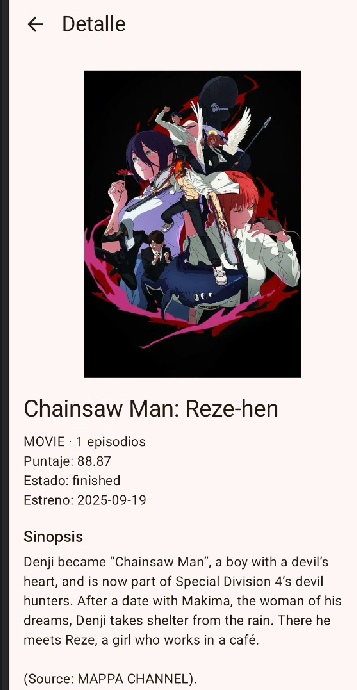
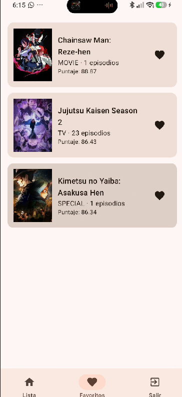
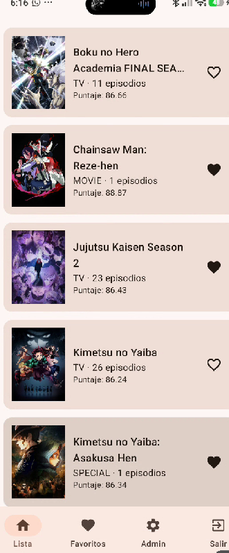
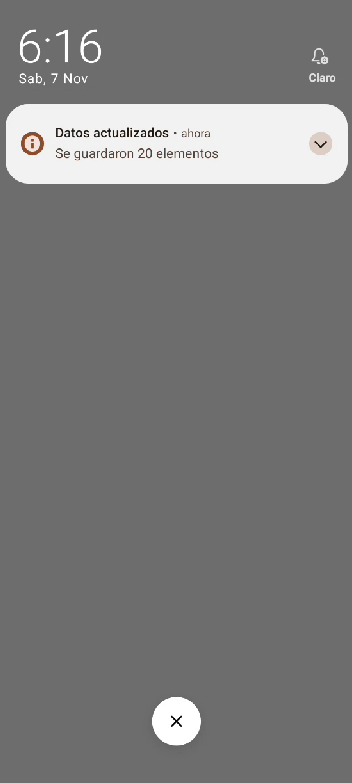

# AnimeTec

App Android para consultar anime, con login por roles, datos de internet,
favoritos guardados en el celular y notificación local.

- **Tema:** Anime, API pública Kitsu (https://kitsu.io/api/edge)
- **Curso:** Programación en Móviles, Tecsup. 
- **Autor:** Eder Yaycate 

## Tecnologías

Kotlin, Jetpack Compose con Material 3, MVVM, Retrofit, Room,
Firebase Authentication y Firestore, y notificaciones locales.

## Arquitectura

- `ui/`: pantallas y ViewModels (solo observan estado y llaman al ViewModel).
- `domain/model/`: modelos que usa la UI (`Item`, `Sesion`, `Rol`).
- `data/remote/`: Retrofit, DTO. `data/local/`: Room. `data/auth/`: Firebase.
- `data/repository/`: `ItemRepository` (interface) e implementación.
- `notification/`: `Notificador` (interface) y su implementación Android.
- Room es la fuente única de verdad: la lista sale de Room y Retrofit solo la actualiza.

## Capturas

Login 

Lista 

Detalle

Favoritos 

Panel de Admin

Notificacion
