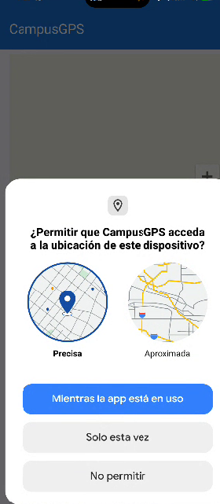
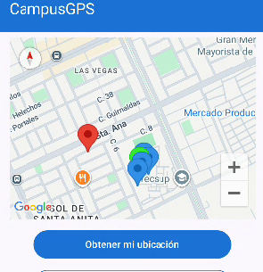
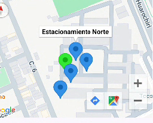
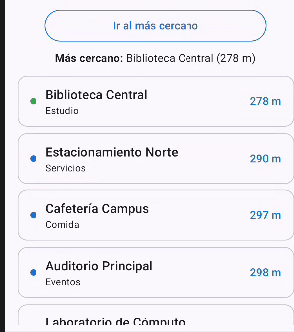
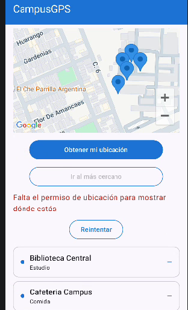
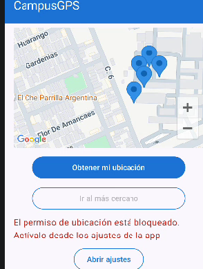

# CampusGPS

App Android en Kotlin y Jetpack Compose que muestra tu ubicación actual dentro del campus de Tecsup Santa Anita, marca los lugares principales, los ordena por distancia y permite ir al más cercano.

Laboratorio GLAB-S13 · Programación en Móviles · Alumno: Eder Marcelo Yaycate Bardales

## Funcionalidades

- Pide el permiso de ubicación en tiempo de ejecución.
- Muestra un mapa de Google Maps centrado en tu posición, con un marcador.
- Muestra 5 marcadores de los lugares del campus.
- Lista los lugares ordenados de menor a mayor distancia.
- Al tocar un lugar de la lista, la cámara se centra en él y la tarjeta queda resaltada.
- El botón "Ir al más cercano" selecciona el lugar más cercano y lo marca en verde.
- Maneja permiso denegado, permiso bloqueado, GPS apagado y ausencia de Google Play Services.

## Estructura de paquetes

```
com.yaycate.campusgps
├── MainActivity.kt
├── data
│   ├── Excepciones.kt                 (GpsApagadoException, SinPlayServicesException)
│   ├── LugaresRepository.kt           (interfaz)
│   ├── LugaresRepositoryLocal.kt      (5 lugares del campus)
│   ├── UbicacionRepository.kt         (interfaz)
│   └── UbicacionRepositoryGoogle.kt   (FusedLocationProviderClient)
├── model
│   └── Modelos.kt                     (Posicion, Lugar, LugarConDistancia, UbicacionUi, TipoError)
├── ui
│   ├── Colores.kt
│   ├── ListaLugares.kt
│   ├── MapaUbicacion.kt               (GoogleMap, cámara y marcadores)
│   ├── MensajeError.kt
│   ├── PantallaMapa.kt
│   └── theme/
├── util
│   ├── Distancia.kt                   (fórmula de Haversine)
│   └── Formato.kt                     (m / km)
└── viewmodel
    ├── CampusViewModelFactory.kt
    └── MapaViewModel.kt
```

## Arquitectura MVVM

```
 ┌──────────────┐   estado / lugares    ┌──────────────────┐   obtenerPosicion()   ┌──────────────────────────┐
 │  Compose UI  │ ◄──── StateFlow ───── │   MapaViewModel  │ ────────────────────► │ UbicacionRepositoryGoogle│ ──► Fused Location
 │ PantallaMapa │ ──── eventos ───────► │                  │                       └──────────────────────────┘
 │ MapaUbicacion│   buscar(), seleccionar()│  distanciaMetros │   obtenerLugares()    ┌──────────────────────────┐
 │ ListaLugares │                       │                  │ ────────────────────► │  LugaresRepositoryLocal  │
 └──────────────┘                       └──────────────────┘                       └──────────────────────────┘
```

La UI solo observa `StateFlow` y envía eventos. El ViewModel contiene la lógica y no depende de Android. Los repositorios ocultan de dónde vienen los datos.

## Configuración

La clave de Google Maps no está en el código. Se guarda en `local.properties` (que no se sube al repositorio):

```properties
MAPS_API_KEY= .... 
```

El manifest la lee con `${MAPS_API_KEY}`, y el archivo `app/build.gradle.kts` la carga desde `local.properties`.

## Capturas

1. Permiso 

2. Mapa con tu ubicación 


3. Marcadores 

4. Lista ordenada

 5. Error 




## Pruebas de aceptación

| Prueba | Resultado esperado | OK |
|---|---|---|
| Abrir la app por primera vez y pulsar el botón | Aparece el cuadro de permiso | [ ] |
| Aceptar el permiso | Se ven latitud, longitud y el marcador "Estás aquí" | [ ] |
| Negar el permiso | Mensaje de error con "Abrir ajustes", la app no se cierra | [ ] |
| Ubicación en el punto base | Los 5 marcadores azules aparecen cerca de tu posición | [ ] |
| Tocar un marcador | Se ve el nombre y la categoría del lugar | [ ] |
| Lista de lugares | Ordenada de menor a mayor distancia, con m o km | [ ] |
| Tocar una tarjeta de la lista | La cámara viaja a ese lugar y la tarjeta queda resaltada | [ ] |
| Ir al más cercano | La cámara va al lugar verde; el botón está deshabilitado antes de buscar | [ ] |
| Cambiar la ubicación del emulador y buscar otra vez | Las distancias, el orden y el lugar verde se actualizan | [ ] |
| Ubicación apagada | Mensaje de GPS con "Reintentar" | [ ] |
| Rotar la pantalla | No se pierden la ubicación ni la lista | [ ] |
| Revisar el repositorio | `git grep "AIza"` no encuentra nada | [ ] |

## Para pensar

**1. ¿Por qué `FusedLocationProviderClient` está dentro del Repository y no en el ViewModel?**
Porque es un detalle de infraestructura que depende de Google Play Services y de un `Context`. Dentro del repositorio, el ViewModel solo conoce la interfaz `UbicacionRepository`. Así puedo probar el ViewModel con un repositorio falso, sin emulador, y cambiar la fuente de ubicación sin tocar la lógica.

**2. ¿Qué diferencia hay entre el permiso de ubicación y la clave de API de Maps? ¿Qué pasa si falta cada uno?**
El permiso de ubicación lo concede el usuario en su teléfono, en tiempo de ejecución. Si falta, la app no puede leer la posición y muestra el mensaje de error con "Reintentar" o "Abrir ajustes". La clave de API identifica la app ante Google Cloud. Si falta o es inválida, el mapa aparece vacío o con una marca de "solo para desarrollo", pero la lista y el cálculo de distancias siguen funcionando.

**3. ¿Por qué la clave va en `local.properties` y no en el código? ¿Qué harías si se subiera a GitHub por error?**
`local.properties` no se versiona, así que la clave no entra al historial de Git. Si se sube por error, lo primero es revocarla o regenerarla en Google Cloud, porque cualquiera que la haya visto puede usarla. Después, quito la clave del historial y verifico con `git grep`. Además, la clave debe estar restringida al paquete y al SHA-1 para que, aunque se filtre, no sirva en otra app.

**4. ¿Dónde calculas la distancia y por qué no en el Composable?**
La calculo en `MapaViewModel`, en `actualizarDistancias`, usando la función pura `distanciaMetros`. Así la lógica queda separada de la UI, se puede probar sin Android y se calcula una sola vez cuando llega la ubicación, no en cada recomposición. El Composable solo muestra lo que recibe.

**5. ¿Qué pasa con la app si el usuario niega el permiso dos veces? ¿Cómo lo manejas?**
Después de la segunda negativa, `shouldShowRequestPermissionRationale` devuelve `false`, y la app lo trata como permiso bloqueado. Muestra el mensaje "El permiso de ubicación está bloqueado" con el botón "Abrir ajustes", que lleva a la configuración de la app. La app no se cierra y la lista de lugares sigue visible; el usuario puede activar el permiso y volver a pulsar el botón.